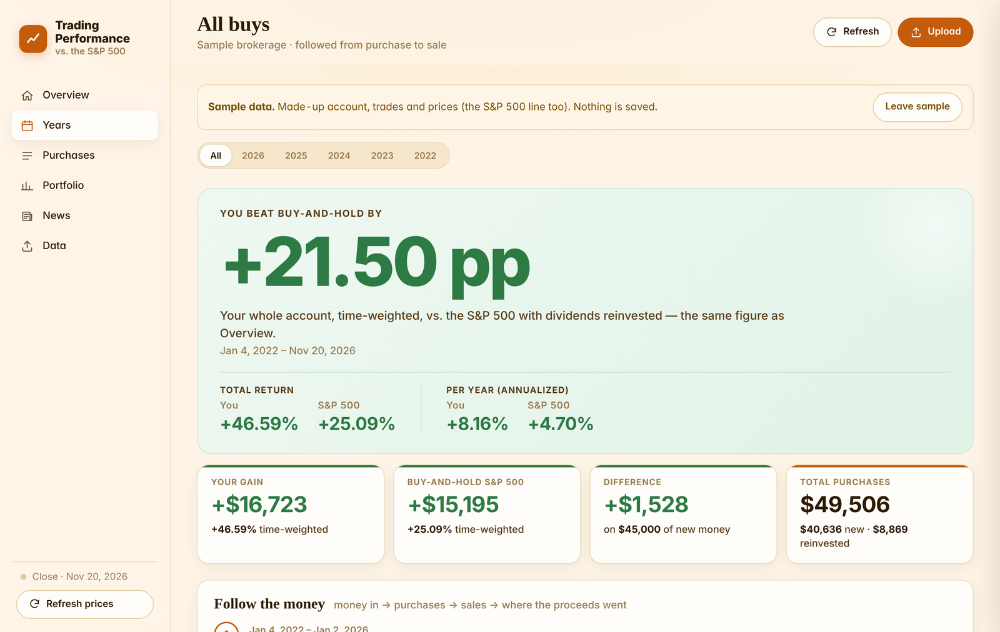
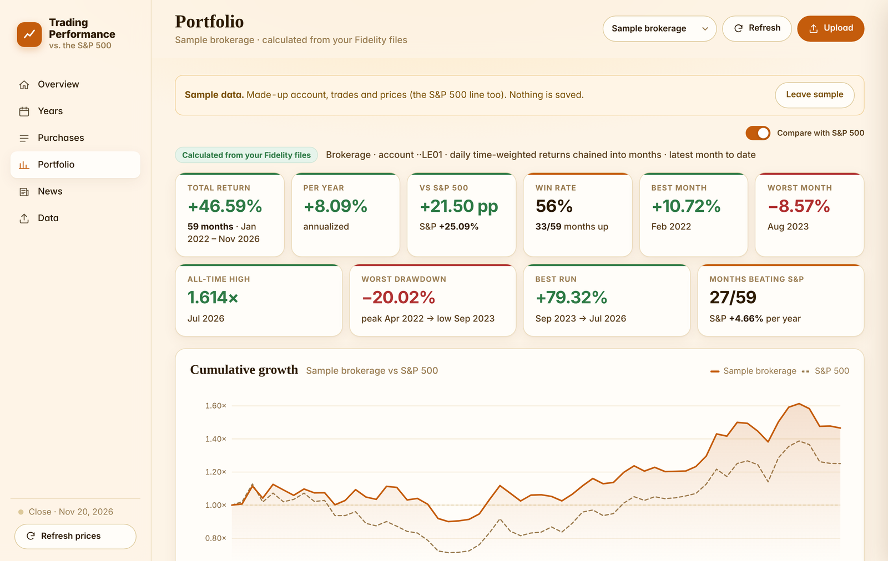

# Trading Performance vs. the S&P 500

See if your trades beat just buying the S&P 500.
It runs on your own computer. Your files stay on it; the internet is only
used to fetch public prices and headlines.

> Not investment advice. Check important numbers against your broker.
> See [DISCLAIMER.md](DISCLAIMER.md).

  

*Screenshots use the built-in sample account: made-up trades and prices.*

## Start

You only need to do steps 1 and 2 once.

**1. Install Python 3 (free).** If you're not sure you have it, download it
from [python.org/downloads](https://www.python.org/downloads/) and install it.
On Windows, tick **"Add python.exe to PATH"** on the first screen of the
installer.

**2. Download the app.** At the top of this page, click the green **Code**
button, then **Download ZIP**. Open your Downloads folder and double-click the
ZIP to unzip it. You get a folder named `TradingPerformance-main`.

**3. Start it.** Open that folder, then:

- **Mac:** double-click `Start.command`. If your Mac refuses to open it,
  right-click the file, choose **Open**, then **Open** again.
- **Windows:** double-click `start.bat`. If a blue "Windows protected your PC"
  box appears, click **More info**, then **Run anyway**.
- **Linux, or if the above doesn't work:** open a terminal in the folder and
  run `python3 server.py`.

A black window opens and your web browser shows the app. The address starts
with `127.0.0.1`, which means it is running on your own computer. **Keep the
black window open while you use the app.** Close it to stop the app. Next time,
double-click the same file again.

**4. Look around.** Click **Try sample data** to see the app with a made-up
account (nothing is saved). To use your own trades, drop in your Fidelity
files. See [Get your Fidelity files](#get-your-fidelity-files) below.

Your data is saved in your user folder, not in the app folder, so you can
update or delete the app safely:

- **Mac:** `~/Library/Application Support/TradingPerformance`
- **Windows:** `%APPDATA%\TradingPerformance`
- **Linux:** `~/.local/share/TradingPerformance`

**Data → Start over** deletes it.

## Get your Fidelity files

Fidelity.com → **Accounts → History** → choose dates → **Download** (CSV).
One file per year is fine. Keep the file names Fidelity gives them.

Only Fidelity is supported for now.

## What you'll see

- **Overview:** your return vs. the S&P 500
- **Years:** how each year's buys did
- **Purchases:** every buy, and whether it beat the index
- **Portfolio:** month-by-month returns
- **News & Market:** headlines and market mood
- **Data:** your files, settings, start over

Sharing screenshots? Turn on **Data → Hide dollar amounts**.

## Screenshots

<table>
  <tr>
    <td> <b>Years</b>: how each year's buys did</td>
    <td> <b>Purchases</b>: every buy vs. the index</td>
  </tr>
  <tr>
    <td> <b>Portfolio</b>: month-by-month growth</td>
    <td> <b>Start here</b>: drop in files or try the sample</td>
  </tr>
</table>

## Common problems

- **Page won't load:** the server isn't running. Start it again.
- **Mac won't open `Start.command`:** right-click it → Open.
- **Windows says Python isn't found:** install it from python.org and tick
  "Add python.exe to PATH".
- **Prices didn't update:** check your internet. The app keeps the last
  prices, and the Data page says what failed.

## More

- [How it's calculated, and what the terms mean](docs/METHODS.md)
- [Where the prices and news come from](DATA_SOURCES.md): free, unofficial
  feeds that may break
- [Contributing](CONTRIBUTING.md), including how to run the tests
- [Changelog](CHANGELOG.md)
- Not supported yet: brokers other than Fidelity, and a combined view of
  all your accounts
- License: MIT
