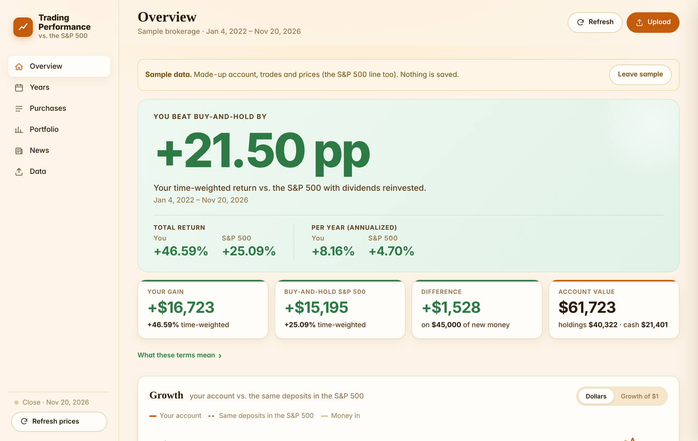
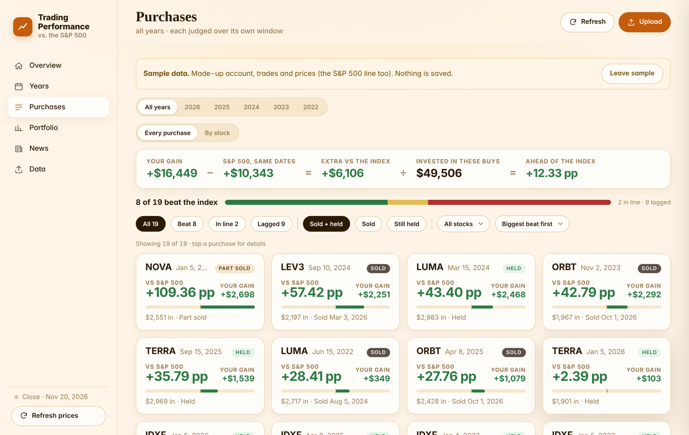
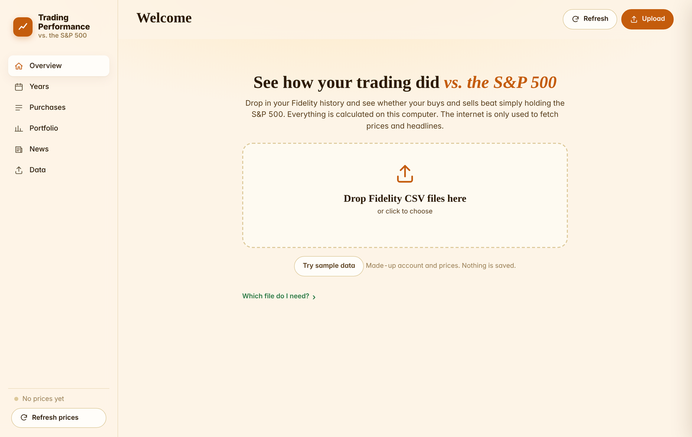

# Trading Performance vs. the S&P 500

See if your trades beat just buying the S&P 500.
It runs on your own computer. Your files stay on it; the internet is only
used to fetch public prices and headlines.

> Not investment advice. Check important numbers against your broker.
> See [DISCLAIMER.md](DISCLAIMER.md).

  

*Screenshots use the built-in sample account: made-up trades and prices.*

## Start

1. Download this repo and unzip it.
2. Start it:
   - **Mac:** double-click `Start.command`
   - **Windows:** double-click `start.bat`
   - **Any OS:** run `python3 server.py` in this folder
3. Your browser opens the app. Drop in your Fidelity files, or click
   **Try sample data** to look around with a made-up account first.

You need Python 3. Nothing else to install.

Your data is saved in your user folder, not in the app folder, so you can
update or delete the app safely:

- **Mac:** `~/Library/Application Support/TradingPerformance`
- **Windows:** `%APPDATA%\TradingPerformance`
- **Linux:** `~/.local/share/TradingPerformance`

**Data → Start over** deletes it.

## Get your Fidelity files

Fidelity.com → **Accounts → History** → choose dates → **Download** (CSV).
One file per year is fine. Keep the file names Fidelity gives them.

Only Fidelity is supported for now.

## What you'll see

- **Overview:** your return vs. the S&P 500
- **Years:** how each year's buys did
- **Purchases:** every buy, and whether it beat the index
- **Portfolio:** month-by-month returns
- **News & Market:** headlines and market mood
- **Data:** your files, settings, start over

Sharing screenshots? Turn on **Data → Hide dollar amounts**.

## Screenshots

<table>
  <tr>
    <td> <b>Years</b>: how each year's buys did</td>
    <td> <b>Purchases</b>: every buy vs. the index</td>
  </tr>
  <tr>
    <td> <b>Portfolio</b>: month-by-month growth</td>
    <td> <b>Start here</b>: drop in files or try the sample</td>
  </tr>
</table>

## Common problems

- **Page won't load:** the server isn't running. Start it again.
- **Mac won't open `Start.command`:** right-click it → Open.
- **Windows says Python isn't found:** install it from python.org and tick
  "Add python.exe to PATH".
- **Prices didn't update:** check your internet. The app keeps the last
  prices, and the Data page says what failed.

## More

- [How it's calculated, and what the terms mean](docs/METHODS.md)
- [Where the prices and news come from](DATA_SOURCES.md): free, unofficial
  feeds that may break
- [Contributing](CONTRIBUTING.md), including how to run the tests
- [Changelog](CHANGELOG.md)
- Not supported yet: brokers other than Fidelity, and a combined view of
  all your accounts
- License: MIT
